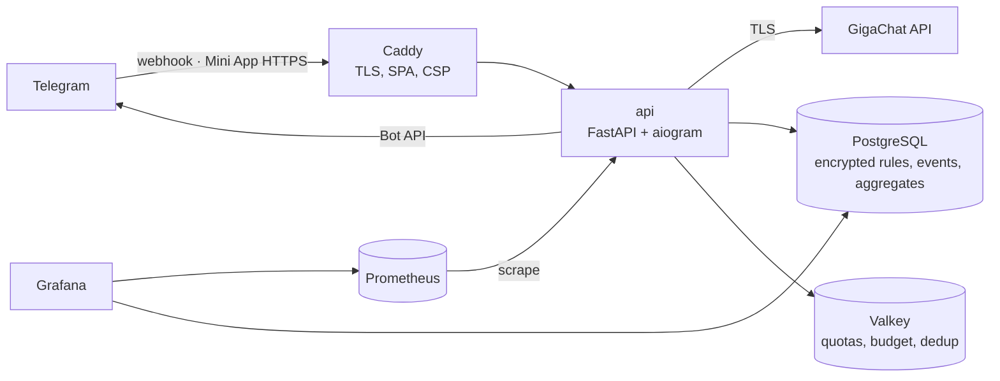

# Svoi Pravila

An AI helper for difficult conversations in Telegram: an inline bot that rewrites a hard message before you send it, and a mini-app that keeps the agreements («rules») two people made — so the next hard message already respects them.

**Production:** running on a VPS (Docker Compose, HTTPS webhook) as the Telegram bot [@Svoi_PravilaBot](https://t.me/Svoi_PravilaBot). Open source; the maintainers' documentation (Russian) is in [`docs/maintainers/`](docs/maintainers/).

## Core product loop

1. In any chat, the user types `@bot <draft>`.
2. After a typing pause the bot offers three variants — «Мягче» (softer), «Твёрже» (firmer), «Проверить» (the author's words, spelling fixed). One LLM call; the pair's rules are part of the prompt.
3. The user picks a variant and sends it. This is an **appeal** — the unit of product analytics (DAU, appeals per DAU).
4. For a hard incoming message the mini-app offers «Расшифровать»: what may be meant and reply options, streamed.
5. «Сделать правилом» turns an insight into a rule proposal; it becomes active when both people accept it and shapes step 2 from then on.

## Architecture

Hexagonal Python service (`domain` ← `application` ← `adapters`/`api` ← `bootstrap`, enforced by import-linter) plus a React mini-app, deployed as one Compose stack:



More diagrams — system context, containers and networks, the inline sequence, «Расшифровать» over SSE, data and observability flows, the load-test stand — in [`02-architecture.md` §11](docs/maintainers/02-architecture.md#11-диаграммы-ред-112). Decisions: [`docs/maintainers/adr/`](docs/maintainers/adr/).

| Layer | Technology |
|---|---|
| Backend | Python, FastAPI, aiogram 3, SQLAlchemy 2 (async) + Alembic, Pydantic, structlog |
| LLM | GigaChat (Lightning for rewrite, Pro for decode) behind a `TextGenerator` port; versioned prompts with eval |
| Storage | PostgreSQL (application-level AES-256-GCM for special-category fields), Valkey |
| Mini-app | React + TypeScript (Vite), API types generated from OpenAPI |
| Edge | Caddy built from source (TLS, strict CSP) |
| Observability | Prometheus, Grafana (provisioned dashboards), daily SQL aggregates |
| Delivery | Docker images (non-root, read-only FS), Compose on a Debian VPS, encrypted daily backups, image scanning (Trivy), hermetic `make ci` |

## Privacy by design

- Conversation texts (drafts, incoming messages, LLM prompts and outputs) are never stored — not in the database, cache, logs, metrics or traces.
- Rules and contact labels are encrypted with a per-user (per-pair) data key; deleting the account destroys the key.
- Analytics events carry an HMAC pseudonym, never the Telegram id or text. Metric labels come only from domain enums.
- Details: [`03-privacy-and-security.md`](docs/maintainers/03-privacy-and-security.md), ADR-0002, ADR-0004.

## Metrics, logs and analytics

| What | Where | Retention |
|---|---|---|
| Usage events: scenario, surface, outcome (ok, refused, limited, invalid output, unavailable), model, prompt version, tokens, latency | PostgreSQL `usage_events` | 13 months |
| Daily aggregates: DAU, appeals, new users, generations and errors, limits hit, tokens; per scenario × surface: outcomes, p50/p95 latency and time to first chunk, tokens; D1/D7 cohorts | `analytics_daily`, `analytics_daily_scenario`, `analytics_cohorts` | unlimited (not personal data) |
| Service metrics: HTTP, Telegram updates, LLM duration and tokens, budget, cache errors, event-loop lag | Prometheus | 15 days |
| Application logs: JSON with PII redaction | container stdout (rotated) | 50 MB per container |

Grafana ships two dashboards (operations and analytics). In production it is served at its own subdomain with personal accounts and the Viewer role for non-owners (no tunnel). It reads the aggregates through a dedicated database role limited to the aggregate tables, which is also how the next stage can connect.

Prometheus evaluates the alert rules and Alertmanager sends them to a private Telegram group of the owners through a separate alert bot. Alerts cover availability, LLM budget and errors, latency, 5xx, cache, analytics jobs and backups. Host metrics (CPU, memory, disk) come from node-exporter; the daily backup writes its result as a metrics file. Alert catalogue and first steps: `deploy/RUNBOOK.md`.

## Load test and LLM cost

- Load test — up to 10 RPS on the core loop and the mini-app API, stress to the first failure, tokens per minute and per second, with Telegram and the LLM mocked inside the stand: task 0045, report in `loadtest/reports/`.
- LLM cost per daily active user in the context of the core loop: [`07-llm-cost-model.md`](docs/maintainers/07-llm-cost-model.md) — a typical user (6 messages through the bot and one «Расшифровать» a day) costs about 2.5 ₽ a day.

## Development

### Prerequisites

- [uv](https://docs.astral.sh/uv/) at `[tool.uv] required-version` in `backend/pyproject.toml` (Python from `backend/.python-version`)
- Node from `miniapp/.nvmrc`
- pnpm on PATH at the `packageManager` version in `miniapp/package.json` (any installer; for example a one-time `corepack enable` done by the developer, not by make). `make toolchain-check` enforces it. If it reports a pnpm version mismatch, `corepack prepare pnpm@12.9.1 --activate` installs the pinned version (use the version currently in `packageManager`).
- Docker (Compose v2) for the local stack (API, one-shot migrations, PostgreSQL 18, Valkey)

### Local setup

```bash
cp .env.example .env
make install
make infra-up
make ci
```

`make install` syncs backend dependencies and points this clone at `.githooks` (`make hooks`). Commit runs format and lint on staged files; push runs `make ci` on the exact pushed commit in a temporary worktree.

`make ci` never reads or writes the repository `.env`. It writes an ephemeral env file outside the repo, uses its own compose project (`svoi-pravila-ci-<run suffix>`) and free host ports per run, so concurrent runs do not affect each other, and removes only that project (volumes included) on exit. Run one GitHub job locally with `make ci JOB=backend` (or `miniapp`, `secrets`, `image`, `stack-smoke`, `ownership-guard`).

`make infra-up` starts only PostgreSQL and Valkey (for gates and tests). Use the Local stack section below to run the application itself.

### Checks

While working, run `make quick` (ruff, mypy, unit pytest; mini-app `tsc` plus eslint/prettier/vitest on files changed vs `origin/master`). Aim for under a minute on a warm cache.

Before each review push, the pre-push hook runs full hermetic `make ci` once on the exact commit. Console lines look like `ci: <job> <stage> PASS|FAIL <s>`. Full stage output is under `.ci-logs/<job>-<stage>.log` (gitignored, cleared at the start of each `make ci`). On `FAIL`, the console also prints the last 40 lines of that log and its path.

### Fresh environment check

Never delete, move, or overwrite an existing repo-root `.env` (it holds credentials that cannot be restored from the repository). To run gates against a generated file:

```bash
make dev-env ENV_FILE=/tmp/sp-fresh.env && make check ENV_FILE=/tmp/sp-fresh.env
```

`make dev-env ENV_FILE=/path/outside/repo.env` creates or updates that file only.

### Local stack

The supported way to run the application locally is the Docker stack (same images intended for the VPS): one-shot migrations, then the API, plus PostgreSQL and Valkey.

Prerequisites: Docker Compose v2, and a repo-root `.env` (from `cp .env.example .env` then `make dev-env` to fill `SP_DATA_KEK`).

```bash
make up      # build images, migrate, start API + mini-app; wait until healthy; print URLs
make logs    # follow api, migrate, and miniapp logs
make ps      # compose status
make down    # stop the full stack; keep named volumes
```

#### Telegram setup (BotFather)

Configure the bot once in [@BotFather](https://t.me/BotFather):

1. **Main Mini App** — set the HTTPS origin of the mini-app (same value as `SP_MINIAPP_URL`, no path). This is the only UI for onboarding, rules, invites, export, and privacy.
2. **`/setjoingroups`** → **Disable** — the bot must not join groups; if it is added, it leaves immediately.
3. **Inline mode** — enable. Rewrite (check / softer / firmer) works via `@bot` in any chat; the button above inline results opens the mini-app (`web_app`), not a deep link into the bot chat.
4. **`/setinlinefeedback`** → **Enabled** (100%) — without this, Telegram never sends `chosen_inline_result`, so the bot cannot record which inline suggestion was used.
5. **Description** (calm, short):  
   `Помощник для трудных разговоров: общие правила с близким человеком и мягкие подсказки в любом чате.`
6. **Short description**:  
   `Правила для двоих и спокойные подсказки в чате.`

There is no command menu. The chat menu button is the mini-app («Мои правила»). Private messages get a single throttled welcome with an «Открыть приложение» button.

#### Mini-app over HTTPS (Telegram menu button)

Telegram requires HTTPS for the Main Mini App and the menu button. For local checks, use the Compose `tunnel` profile (Cloudflare quick tunnel to the `miniapp` service):

```bash
make up
make miniapp-tunnel
```

In the tunnel logs, copy the printed `https://….trycloudflare.com` origin into **your own** `.env` as `SP_MINIAPP_URL` (no path or query). Restart the API so the bot can call `setChatMenuButton` on startup, then open the bot’s chat menu button «Мои правила».

The trycloudflare URL **changes every run**. Stop the tunnel with `make miniapp-tunnel-down`. The executor never edits the owner’s `.env`.

#### Analytics dashboard

Grafana reads only the aggregate tables (`analytics_daily`, `analytics_daily_scenario`, `analytics_cohorts`) via the configured Grafana DB user (`SP_GRAFANA_DB_USER`, default `grafana_reader`), a member of `svoi_analytics_read` with at most 5 connections, a statement timeout and a temporary file limit. In production it has no published port: Caddy serves it on `SP_GRAFANA_DOMAIN` (own DNS record, own certificate), and it sits on internal networks only. Locally it stays on `127.0.0.1`.

The one-shot `migrate` service needs a Postgres role with `CREATEROLE` (not superuser) so it can create the analytics group role and the Grafana LOGIN role. Because `temp_file_limit` is a superuser-only parameter, a non-superuser migrate role also needs `GRANT SET ON PARAMETER temp_file_limit` from a superuser. Full separation of migrate / app / analytics roles is planned for task 0022.

Locally:

```bash
make up
make observability-up
```

Open `http://127.0.0.1:${GRAFANA_PORT:-3000}` (admin password from `SP_GRAFANA_ADMIN_PASSWORD` in your env file). Stop with `make observability-down`.

On the VPS, Grafana is opened in the browser at `https://<SP_GRAFANA_DOMAIN>/` with a personal account; the runbook describes the subdomain, the mentor's Viewer account and the alert bot.

Data lives in Docker named volumes (`postgres_data`, `valkey_data`). To reset local data:

```bash
docker compose down -v
```

That destroys local PostgreSQL and Valkey data.

Tests never write to the manual-testing database: they use a dedicated PostgreSQL database named `<POSTGRES_DB>_test` (for example `svoi_pravila_test`) and Valkey logical database `15`.

The integration suite connects to Postgres as the compose admin role (`POSTGRES_USER`) and requires that role to be a **superuser** (the default `postgres` image user is). At session start it asserts `rolsuper`; otherwise it fails with a clear message naming that requirement. A non-superuser admin cannot create/drop the temporary databases and roles the suite needs.

### Make targets

| Target | Purpose |
|--------|---------|
| `install` | Sync backend deps with uv and set `core.hooksPath` to `.githooks` |
| `hooks` | Point this clone at `.githooks` (repo-local git config only) |
| `toolchain-check` | Compare local Python, uv, Node, pnpm, Docker, and image digests with pins |
| `ci` | Hermetic local mirror of GitHub CI (`make ci JOB=<name>` for one job). Never touches `.env`. Quiet console; full logs in `.ci-logs/`. |
| `quick` | Fast local checks while working (ruff, mypy, unit pytest; mini-app tsc + changed-file eslint/prettier/vitest) |
| `build` | Build app images (`svoi-pravila-api:local`) |
| `up` | Build and start the full stack (profile `app`); wait until API/mini-app are healthy |
| `down` | Stop the full stack; keep volumes |
| `logs` | Follow `api`, `migrate`, and `miniapp` logs |
| `ps` | Show compose service status |
| `miniapp-check` | OpenAPI drift check + mini-app lint/test/build |
| `miniapp-tunnel` | Start Cloudflare quick tunnel to the mini-app (profile `tunnel`) |
| `miniapp-tunnel-down` | Stop the tunnel service |
| `observability-up` | Start Grafana (profile `observability`) after migrate; bind `127.0.0.1` only |
| `observability-down` | Stop the Grafana service |
| `fmt` | Ruff format |
| `lint` | Ruff lint |
| `typecheck` | mypy |
| `imports` | import-linter contracts |
| `test-unit` | Unit tests |
| `test-integration` | Integration tests (requires `infra-up`) |
| `test` | Unit + integration with coverage gates |
| `audit` | `pip-audit` against the lockfile |
| `secrets` | gitleaks scan of the working tree |
| `image` | Build API and mini-app CI images |
| `image-scan` | Trivy HIGH/CRITICAL scan of both CI images |
| `stack-smoke` | Compose stack smoke (env file outside the repo) |
| `ops-check` | Validate Prometheus config, alert rules (with `promtool test rules`), Alertmanager config and the Telegram template in the pinned upstream images |
| `prod-smoke` | Production-shaped smoke on throwaway secrets: Grafana subdomain, Viewer limits, alert delivery to a stub, host and backup metrics, backups. `PROD_SMOKE_KEEP=1` leaves the stack running and prints the local Grafana URL |
| `prod-smoke-down` | Remove a stack left by `PROD_SMOKE_KEEP=1` |
| `ownership-guard` | Forbid task-branch edits to CTO-owned paths (`BASE=<ref>`) |
| `migrations-check` | Alembic upgrade + check against compose DB |
| `infra-up` / `infra-down` | Start/stop local Postgres and Valkey (tests/gates) |
| `check` | Backend and mini-app gates (no secrets scan) |

Agent instructions and ownership: [`AGENTS.md`](AGENTS.md).
