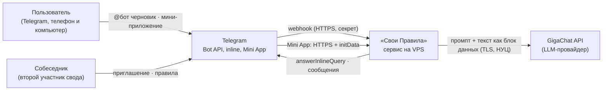
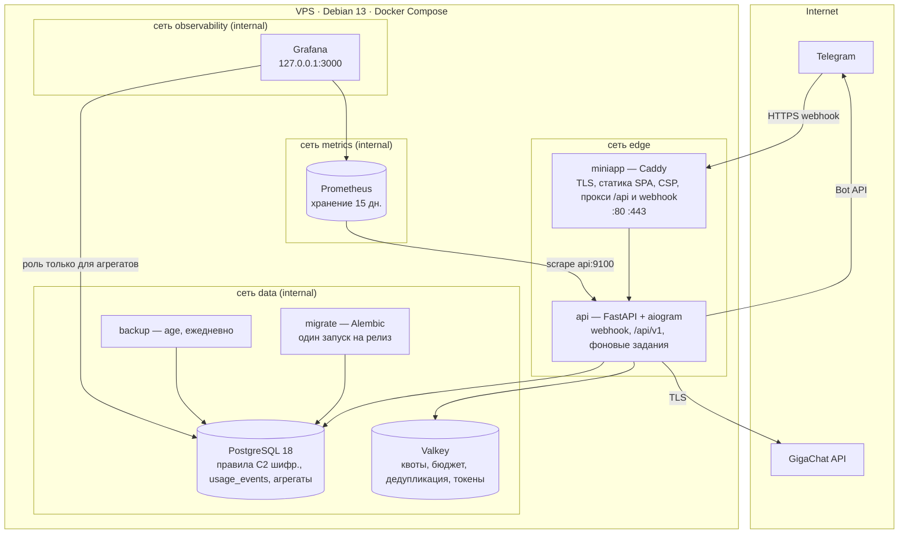
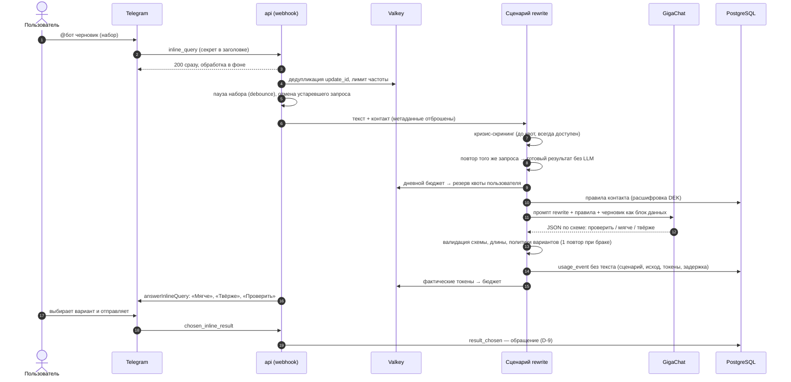
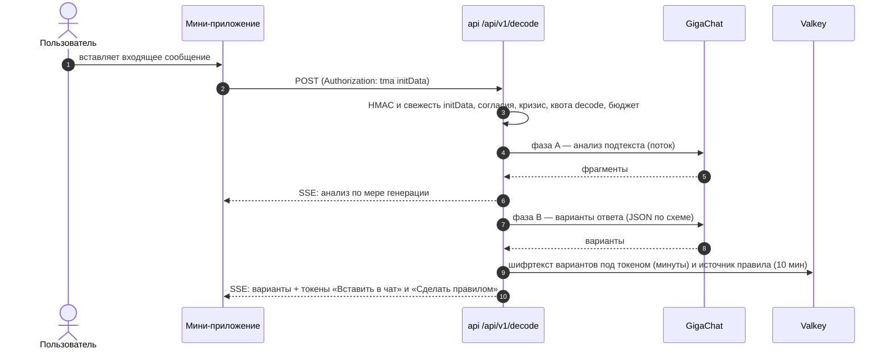
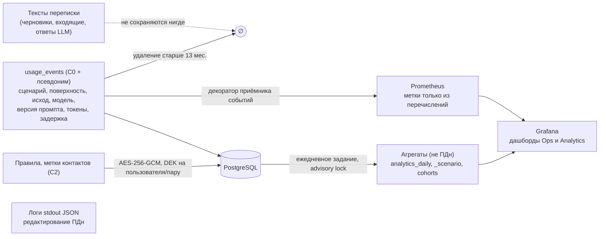
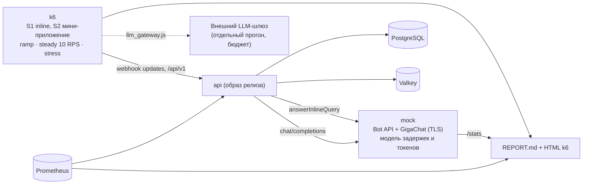

# Архитектура «Свои Правила»

Владелец документа: Claude (CTO). Исполнители этот документ не редактируют; изменения архитектуры фиксируются через ADR в `adr/`.
Редакция: 1.12 · 2026-10-14 (ред. 1.12 — §11 диаграммы: контекст, контейнеры и сети, основной цикл inline, «Расшифровать», данные и наблюдаемость, нагрузочный стенд; ред. 1.11 — сервер: Debian 13, бэкапы локально на сервере; ред. 1.10 — эксплуатационные метрики Prometheus; ред. 1.9 — квоты и дневной бюджет LLM, ADR-0009; ред. 1.8 — продуктовая аналитика: определения D-9, агрегаты, когорты, ежедневные задания; ред. 1.7 — мини-приложение: «Расшифровать» потоком SSE, каталог текстов приватности; ред. 1.6 — API мини-приложения: проверка `initData`, `/api/v1`; ред. 1.5 — кнопка «Сделать правилом»: одноразовый токен с ключом, операция `suggest_rule`; ред. 1.4 — кандидаты правил: `RuleSuggestion`, `ToneSignal` — D-6; ред. 1.3 — inline: определение p95, повторное использование результата для одинакового запроса; ред. 1.2 — debounce и отмена до провайдера, prepared results с ключом в токене)

---

## 1. Структура репозитория

```
svoi-pravila/
├── AGENTS.md                      # правила всех исполнителей (CTO-owned); области — backend/AGENTS.md, miniapp/AGENTS.md
├── .github/                       # CI, шаблоны Issue и PR, CODEOWNERS (шаблоны и CODEOWNERS — CTO-owned)
├── docs/
│   └── maintainers/               # план, архитектура, приватность, процесс, ADR (CTO-owned)
├── backend/                       # Python-сервис (самостоятельный uv-проект)
│   ├── pyproject.toml
│   ├── src/svoi_pravila/
│   │   ├── domain/                # сущности, value objects, доменные ошибки, политики
│   │   ├── application/           # сценарии (use cases), порты, DTO
│   │   ├── adapters/
│   │   │   ├── persistence/       # SQLAlchemy-модели, репозитории, unit of work
│   │   │   ├── cache/             # Valkey: лимиты, дедупликация, prepared results
│   │   │   ├── llm/               # GigaChat-адаптер, реестр промптов
│   │   │   ├── system/            # часы, UUIDv7, генератор токенов
│   │   │   └── channels/telegram/ # aiogram: роутеры, презентеры, клавиатуры
│   │   ├── api/                   # FastAPI: webhook, API mini-app, health
│   │   ├── crypto/                # общий модуль: AES-256-GCM, envelope encryption (ADR-0004)
│   │   ├── observability/         # логирование, редактирование ПДн, метрики
│   │   ├── config.py              # единственная точка чтения окружения
│   │   └── bootstrap.py           # composition root: сборка зависимостей
│   ├── migrations/                # Alembic
│   ├── prompts/                   # версии системных промптов LLM (данные, не код)
│   ├── evals/                     # эталонный набор и раннер eval
│   └── tests/{unit,integration,contract}/
├── miniapp/                       # появляется в промпте 0013
├── deploy/                        # compose для сервера, Caddyfile, runbook
├── .github/workflows/
└── Makefile                       # единая точка запуска гейтов
```

## 2. Слои и правила зависимостей

```
domain  ←  application  ←  adapters / api  ←  bootstrap
```
- `domain` не импортирует ничего, кроме стандартной библиотеки. Никаких Pydantic, SQLAlchemy, aiogram.
- `application` импортирует только `domain`. Здесь объявлены порты (`typing.Protocol`): `LLM`, `RuleRepository`, `UserRepository`, `ConsentRepository`, `UnitOfWork`, `Cipher`, `RateLimiter`, `PreparedResultStore`, `EventSink`, `Clock`, `IdGenerator`.
- `adapters/*` реализуют порты и не импортируют друг друга. Общие инфраструктурные модули, доступные адаптерам: `observability` и `crypto`; `domain` и `application` их не импортируют, а сами они не импортируют слои приложения.
- `api` и `adapters/channels` вызывают только сценарии `application`, не репозитории напрямую.
- `bootstrap.py` — единственное место, где адаптеры связываются с портами.
- Правила проверяются `import-linter` в CI. Нарушение = красный гейт.

## 3. Домен

| Сущность | Суть | Инварианты |
|---|---|---|
| `User` | пользователь канала | возраст 18+ подтверждён до первого сценария; без активного согласия сценарии недоступны |
| `Consent` | факт согласия | тип (`personal_data`, `special_category`), версия текста, хэш текста, время, канал; отзыв — отдельное событие |
| `Contact` | «важный человек» пользователя | метка (псевдоним, задаёт пользователь), тип отношений; соло или связан с `Pair` |
| `Pair` | совместный свод двух пользователей | ровно 2 участника; правило активно, когда приняли оба |
| `Rule` | договорённость | категория (`taboo_topic`, `how_to_ask`, `apology`, `conflict_protocol`, `other`), статус (`proposed` → `active` → `archived`), автор, дата вступления — для цитаты |
| `RuleRevision` | история правила | правки не теряются; цитата всегда ссылается на ревизию |
| `RuleSuggestion` | кандидат от системы | становится правилом только после подтверждения (D-6); источник `tone` (шаблон каталога по выбору жёсткости) или `decode` (LLM по кнопке, 0011.2); `pending` → `accepted` / `dismissed`; тон-кандидат для пары «контакт + жёсткость» предлагается не более одного раза; текст зашифрован DEK пользователя |
| `ToneSignal` | последние выборы жёсткости в inline по контакту | не более 10 последних значений; без текста; удаляется с аккаунтом; кандидат — при ≥ 5 выборах и доле одной жёсткости ≥ 80 % |
| `Invite` | приглашение второго | одноразовое, TTL 7 дней, хранится только хэш токена |
| `UsageEvent` | факт обращения | сценарий, поверхность, модель, латентность, исход; без текста |

Сценарии `application`: `SoftenDraft`, `DecodeIncoming`, `HelpSay`, `GrantConsent`, `RevokeConsent`, `ConfirmAge`, `CreateContact`, `SetActiveContact`, `ProposeRule`, `AcceptRule`, `ArchiveRule`, `SuggestRuleFromSignal`, `CreateInvite`, `AcceptInvite`, `LeavePair`, `RecordChosenVariant`, `ExportMyData`, `DeleteMyAccount`.

## 4. LLM-слой

- Порт `LLM`: структурированная генерация (ответ валидируется Pydantic-схемой) и стриминговая генерация. Параметры: модель, бюджет токенов, дедлайн.
- **Реестр промптов:** каждый системный промпт — файл с `id` и `version` в `backend/prompts/`. В `UsageEvent` пишется версия промпта. Изменение промпта = новая версия + прогон eval.
- **Ответ модели — всегда схема:** варианты (текст, жёсткость), `applied_rule_ids`, `safety` (`ok` / `crisis` / `refuse_manipulation`), для «Расшифровать» — гипотезы о подтексте. Невалидный ответ → одна повторная попытка → понятная ошибка пользователю.
- **Недоверенный ввод:** текст пользователя и собеседника передаётся отдельным блоком данных с явной инструкцией модели не исполнять инструкции из него; на выходе — проверка длины, отсутствия ссылок и служебной разметки.
- **Дедлайны:** inline — цель p95 < 1,5 с от конца паузы набора (debounce) до отправки ответа Telegram; сама пауза — осознанная экономия токенов и в цель не входит (ред. 1.3). Замер — C0-лог `inline_answered` с `answer_latency_ms`; метрики и алерты — в 0020. Бенчмарк 0005-d: Lightning, вызов провайдера p95 1,10 с («Смягчить») и 1,34 с («Помоги сказать»). Личка — стриминг, первый токен < 1 с.
- **Устойчивость:** таймауты, ограниченные ретраи с джиттером только для идемпотентных ошибок, circuit breaker, проактивное обновление OAuth-токена GigaChat до истечения, пул соединений.
- **TLS:** доверенный корень НУЦ Минцифры подключается через конфигурацию trust store образа; отключение проверки сертификата запрещено.

## 5. Канал Telegram

- **Webhook:** проверка заголовка `X-Telegram-Bot-Api-Secret-Token` (сравнение за постоянное время), ответ 200 сразу, обработка — фоновой задачей процесса с корректным graceful shutdown; дедупликация по `update_id` (Valkey, TTL).
- **Inline:** запрос пользователя ждёт паузу набора (debounce); новый запрос того же пользователя отменяет предыдущий, пока тот не дошёл до провайдера. Уже начатый вызов LLM доводится до конца и учитывается в событиях, но устаревший результат не отправляется (токены всё равно оплачены, отмена их не вернёт). `is_personal=true`; межпользовательского кэша нет. Повторный запрос того же пользователя с тем же нормализованным текстом, сценарием, контактом и набором правил получает уже готовый или ещё генерируемый результат без нового вызова LLM (ред. 1.3): только память процесса, срок — `cache_time` inline, ограниченный размер, без записи на диск, в Valkey и логи; удаление аккаунта и отзыв согласий стирают записи пользователя. Выбор контакта: активный контакт по умолчанию; явный тег контакта в начале запроса и кнопка мини-приложения — с появлением управления контактами. Сценарий: без префикса — «Смягчить» черновик; префикс намерения — «Помоги сказать».
- **Prepared results:** вариант из лички шифруется (AES-256-GCM) случайным ключом, который живёт только в токене; в Valkey лежит лишь шифртекст под идентификатором токена (TTL — минуты, AAD связывает с псевдонимом пользователя). Кнопка `switch_inline_query_chosen_chat` подставляет токен в inline-запрос; inline-обработчик того же пользователя отдаёт готовый текст мгновенно, без вызова LLM. Токен действует до выбора результата (`chosen_inline_result`) или до истечения TTL.
- **Источник кандидата правила (ред. 1.5):** после успешного «Расшифровать» входящий текст и id активного контакта шифруются (AES-256-GCM) случайным ключом, который живёт только в callback-данных кнопки «Сделать правилом»; в Valkey лежит лишь шифртекст под коротким id (TTL 10 минут, AAD связывает с псевдонимом пользователя), тот же механизм, что у prepared results. Токен одноразовый: при нажатии запись удаляется до вызова модели, повторное нажатие модель не вызывает. Сервер без нажатия пользователя расшифровать текст не может.
- **Личка:** стриминг через `sendMessageDraft`; итоговое сообщение с вариантами; кнопки «Копировать», «Вставить в чат», «Это правило для нас» (предложение правила).
- **Граница адаптера:** `forward_origin`, имена, username, id собеседника отбрасываются до вызова сценария. Сценарий получает только текст.
- **Презентеры:** тексты интерфейса — в одном каталоге локализации (ru на MVP), не размазаны по обработчикам.

## 6. Мини-приложение (с промпта 0013)

- Статическое SPA, раздаётся Caddy, строгая CSP (скрипты только свои и `telegram.org`), без сторонней аналитики.
- Аутентификация: каждый запрос несёт `initData` (заголовок `Authorization: tma …`); сервер проверяет HMAC (проверка подписи — `aiogram.utils.web_app` в адаптере Telegram) и свежесть `auth_date` (по умолчанию ≤ 1 часа); из `initData` в сценарий передаётся только Telegram id, имя, username и фото отбрасываются на границе.
- API мини-приложения — `/api/v1/…` в том же сервисе; ответы `Cache-Control: no-store`; ошибки — типизированные коды без эха пользовательского текста; лимит запросов на пользователя; тот же онбординг и согласия, что в боте (ред. 1.6).
- Авторизация: любой доступ к контакту/паре/правилу проверяется по членству — в сценарии, а не в роутере.
- Типы API — только из сгенерированного по OpenAPI клиента.
- В `localStorage` / `DeviceStorage` никаких ПДн и текстов; допустимы только UI-настройки.
- «Расшифровать» в мини-приложении (ред. 1.7): `POST /api/v1/decode` отвечает потоком Server-Sent Events через `fetch` (EventSource не умеет заголовок `Authorization`); тот же сценарий `DecodeIncoming`, те же лимиты, проверка кризиса и события использования с поверхностью `miniapp`; варианты — с токенами prepared results для «Вставить в чат» и одноразовым токеном источника для «Сделать правилом». Caddy не буферизует поток.
- Тексты о приватности (экспорт, отзыв, удаление) — единый каталог `svoi_pravila/privacy/` для бота и API; мини-приложение получает их через `GET /api/v1/privacy/texts`.

## 7. Данные и шифрование

- **Классы данных:** `C0` — не ПДн; `C1` — идентификаторы (telegram id); `C2` — ПДн специальной категории (текст правил, метки контактов).
- `C2` шифруется на уровне приложения: AES-256-GCM, ключ данных (DEK) на пользователя, обёрнутый мастер-ключом (KEK) из секретов сервера. AAD = идентификатор записи + версия схемы. Удаление аккаунта = уничтожение DEK (crypto-shredding) + удаление записей.
- Для общего свода — собственный DEK пары, обёрнутый KEK (ADR-0004).
- `usage_events` содержат HMAC-псевдоним пользователя (секретный pepper), не telegram id.
- Тексты переписки не сохраняются нигде: ни в БД, ни в Valkey (кроме prepared result на минуты, зашифрованного), ни в логах, ни в метриках, ни в трейсах.
- Сроки хранения: см. `03-privacy-and-security.md`.

## 8. Наблюдаемость

- structlog, JSON, обязательный процессор редактирования: запрещённые ключи (`text`, `message`, `draft`, `rule_text`, `query`, …) удаляются; значения обрезаются; исключения логируются без `repr` аргументов.
- **Prometheus (ред. 1.10, задача 0020.1).** Метрики отдаются на отдельном внутреннем порту сервиса: он не публикуется на хост и недоступен через Caddy. Prometheus находится во внутренней сети `metrics` вместе с `api`, а Grafana видит Prometheus через сеть `observability`.
- **Значения меток — только из перечислений домена** (сценарий, поверхность, исход, вид лимита, модель, версия промпта, шаблон маршрута, класс статуса). Без ПДн, без идентификаторов, без текста. Кардинальность ограничена и проверяется тестом.
- **Источник метрик LLM — события использования.** Адаптер-декоратор приёмника событий обновляет метрики по тем же данным, что пишутся в `usage_events`, поэтому слой приложения о метриках не знает. HTTP-метрики собирает ASGI middleware, метрики обновлений Telegram — middleware aiogram, ошибки кэша — адаптер Valkey.
- Задержка цикла событий измеряется отдельной метрикой: это основной индикатор перегрузки процесса для нагрузочного теста (0020.2).
- Внешние SaaS для логов и ошибок не используем (трансграничная передача).

### Продуктовая аналитика (ред. 1.8, задачи 0017.1–0017.2)
- **Обращение** (D-9, уточнение 06.10). Обращением считается:
  - событие `result_chosen` (вариант выбран в inline);
  - событие `generation` на поверхностях `dm` или `miniapp` с исходом `ok`, `refused` или `screened`: пользователь увидел окончательный ответ.
- **Не обращения:**
  - исход `limited` (сработала квота или бюджет, ADR-0009);
  - `generation` на поверхности `inline` (набор запроса);
  - исходы `unavailable` и `invalid_output` (считаются ошибками);
  - сценарий `suggest_rule` (побочная операция).
- **Активный пользователь дня** — псевдоним хотя бы с одним обращением за день. DAU и «обращения на DAU» считаются по этому определению.
- **День** — календарный день в часовом поясе `SP_ANALYTICS_TIMEZONE` (по умолчанию `Europe/Moscow`). Границы дня вычисляет Postgres.
- **Когорты D1/D7.** Когорта дня C — пользователи, чьё первое обращение среди хранимых событий пришлось на C. D1 — доля когорты с обращением в день C+1, D7 — в день C+7.
- **Агрегаты.** Отдельные таблицы без псевдонимов и идентификаторов:
  - итоги дня;
  - срез по сценарию и поверхности: обращения, пользователи, исходы, p50/p95 задержки и TTFC по успешным генерациям, токены;
  - когорты.

  Агрегаты не являются ПДн: хранятся без срока, удаление аккаунта их не меняет.
- **Ежедневные задания:**
  - агрегаты за прошедший день;
  - пересчёт когорт в окне 8 дней;
  - удаление `usage_events` старше 13 месяцев партиями.

  Это фоновая задача того же сервиса (ADR-0001 п. 2): без отдельного воркера и очереди. Единственный исполнитель обеспечивается advisory lock в Postgres. Задания идемпотентны и догоняют пропущенные дни. Журнал запусков — таблица `job_runs`.
- **Где задано определение обращения.** Рабочее — SQL-агрегатор адаптера. Эталонная реализация в домене служит тестам: на одном наборе событий результаты обязаны совпасть.
- **Дашборд** (0017.2) — Grafana во внутренней сети compose. Она только читает агрегатные таблицы через отдельную роль БД, без доступа к `usage_events`; доступ — через SSH-туннель.

## 9. Конфигурация и секреты

- Единственная точка чтения окружения — `config.py` (pydantic-settings), секреты типа `SecretStr`.
- `.env.example` документирует каждую переменную; реальные секреты — только на сервере (файл вне репозитория с правами 600) и в секретах CI.
- Секреты: токен бота, webhook secret, учётные данные GigaChat, KEK, pepper аналитики, пароли БД/Valkey.

## 10. Развёртывание

- Один образ бэкенда (multi-stage, uv, non-root, read-only FS, healthcheck).
- Сервер: docker compose — `api`, `postgres`, `valkey`, `caddy`; миграции — отдельный одноразовый шаг релиза.
- Хост: VPS с Debian 13 (ADR-0011), SSH только по ключу, firewall (наружу открыты только 80/443), автоматические обновления безопасности. Postgres, Valkey, метрики — только во внутренней сети compose.
- Бэкапы Postgres: ежедневно, шифруются `age` до записи на диск, хранятся на сервере; внешняя копия через rclone — по желанию (ADR-0011, дополнение 08.10). Проверка восстановления — ежемесячно, по RUNBOOK.
- Переносимость: развёртывание на любом Linux-сервере с Docker по runbook, без привязки к API провайдера.
- Окружения: `local`, `staging` (свой бот), `production` (свой бот). Данные между окружениями не переносятся.
- Порядок выхода (ADR-0005): полный стек собирается и вручную тестируется локально в Docker теми же образами; на VPS — только после полной приёмки. Обновления Telegram: `polling` локально, `webhook` на VPS, один обработчик.

## 11. Диаграммы (ред. 1.12)

Диаграммы — в Mermaid: GitHub рисует их прямо в документе, исходник правится вместе с текстом. Они показывают то, что описано в §2–§10, и не вводят новых решений.

### 11.1 Контекст



### 11.2 Контейнеры и сети на сервере

Один VPS, Docker Compose (`deploy/compose.prod.yaml`). Наружу открыты только 80/443 (Caddy); Grafana — только `127.0.0.1` через SSH-туннель. Сети `data`, `metrics`, `observability` — `internal`, без выхода наружу.



### 11.3 Основной цикл продукта: inline «Мягче / Твёрже / Проверить»

Core Product Loop: человек пишет трудное сообщение в любом чате → получает три варианта → выбирает и отправляет; договорённости пары подмешиваются в промпт. Обращение (D-9) — выбранный вариант (`result_chosen`).



### 11.4 «Расшифровать» в мини-приложении (SSE)



### 11.5 Данные, приватность и наблюдаемость



### 11.6 Нагрузочный стенд (задача 0045)

Те же образы, что на сервере, лимиты памяти прода; Telegram и GigaChat заменены моками внутри стенда — живых вызовов 0. Отдельный замер внешнего OpenAI-совместимого шлюза LLM — только с бюджетом в задаче.


